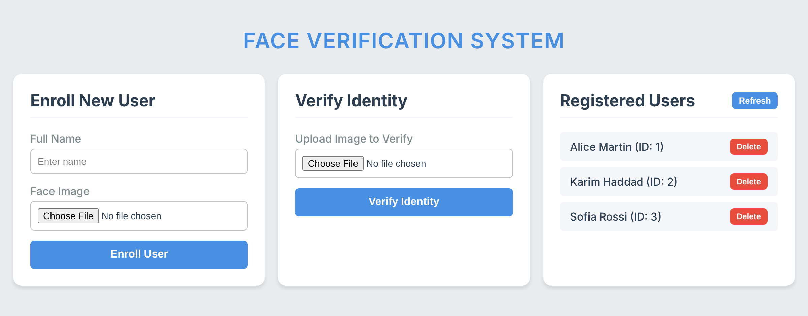
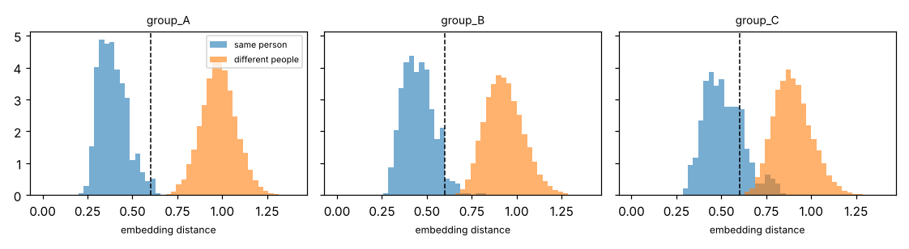

# Face Verification System

A face enrolment and verification service: enrol a user from one photo, then check new photos against them. Built with Flask, the `face_recognition` library (dlib ResNet, 128-d embeddings) and MySQL.

Version 2 adds what is needed to run it responsibly:

- **Production setup:** Docker and Compose, a Gunicorn server, health checks and Prometheus metrics.
- **CI:** tests and a container smoke test on every push.
- **Fairness audit:** error rates per demographic group, with a generated model card.
- **Anti-spoofing:** a baseline that detects presentation attacks such as printed photos.
- **Experiment tracking:** audit and training runs are logged with MLflow.



## How it works

1. **Enrol:** detect exactly one face, compute its 128-d embedding, and store the name and embedding.
2. **Verify:** detect one face in the probe image and compute its embedding.
   - Without `user_id`, it does **1:N identification**: compare with every enrolled user and take the closest.
   - With `user_id`, it does **1:1 verification**: compare only with that user, i.e. "is this person who they claim to be?"
3. **Decide:** it's a match if the Euclidean distance is ≤ `MATCH_TOLERANCE` (default 0.6). The response includes the distance and the threshold.
4. **Liveness (optional):** if a liveness model is configured, a probe judged to be a photo or a screen is rejected with `403`.

## API

| Method | Route | Input | Returns |
|---|---|---|---|
| POST | `/enroll` | form: `name`, `image` | new user id |
| POST | `/verify` | form: `image`, optional `user_id` | match, name, distance, threshold, mode (`1:N` or `1:1`) |
| GET | `/users` | | enrolled users (no embeddings) |
| DELETE | `/users/<id>` | | confirmation |
| GET | `/health` | | database status, model, version (`503` if the database is down) |
| GET | `/metrics` | | Prometheus metrics |

Errors are JSON. Uploads are limited to `MAX_UPLOAD_MB`, and internal errors return a request id instead of a stack trace.

## Run it

**With Docker** (MySQL + app):

```bash
DB_PASSWORD=choose-one docker compose up --build    # first build compiles dlib, ~10 min
# open http://localhost:5000
```

**Single container with SQLite:**

```bash
docker build -t faceverify . && docker run -p 5000:5000 -v fvdata:/data faceverify
```

**Without Docker:**

```bash
pip install -r requirements.txt          # needs CMake and a C++ compiler for dlib
mysql -u root -p < schema.sql
export DB_USER=root DB_PASSWORD=...      # or DB_BACKEND=sqlite to skip MySQL
python app.py
```

Settings (environment variables):

| Variable | Purpose |
|---|---|
| `DB_BACKEND` | `mysql` or `sqlite` |
| `DB_HOST`, `DB_USER`, `DB_PASSWORD`, `DB_NAME` | MySQL connection |
| `SQLITE_PATH` | SQLite database file |
| `MATCH_TOLERANCE` | match threshold (default 0.6) |
| `MAX_UPLOAD_MB` | upload size limit |
| `LIVENESS_MODEL` | path to a trained liveness model (empty = off) |
| `LIVENESS_THRESHOLD` | spoof probability above which a probe is rejected |
| `LOG_LEVEL` | logging level |

**Upgrading from version 1:** embeddings used to be stored with `pickle`. Unpickling can execute code, so a tampered database could have attacked the server. They are now raw float64 bytes. Old rows are still read through a restricted unpickler that only allows NumPy arrays. Convert them once:

```bash
python -m faceverify.cli migrate
```

## Monitoring

`/metrics` exposes, in Prometheus format:

- request counts and latency per endpoint;
- outcomes: match, no match, no face, multiple faces, spoof;
- **the distribution of best-match distances**.

A shift in that distribution (new camera, lighting, different users) changes accuracy without any error showing. Watching it is the simplest form of model monitoring. Each response carries an `X-Request-ID` that also appears in the JSON logs.

## Fairness audit

Face recognition error rates often differ between demographic groups (NIST FRVT Part 3, 2019). The audit measures this for this system, the way NIST does:

- **Genuine pairs:** two images of the same person.
- **Impostor pairs:** two different people from the same group.
- **FNMR** (genuine users rejected), **FMR** (impostors accepted) and **EER**, per group.
- **Disparity:** worst group ÷ best group.
- **Threshold choice:** the threshold that gives a target FMR (default 1 in 1,000) overall, instead of the library's 0.6.

```bash
python -m faceverify.cli audit --labels data/labels.csv      # CSV: path,identity,group
python -m faceverify.cli audit --synthetic                   # demo without data
```

The output is a `MODEL_CARD.md` plus a distance plot. With MLflow installed, every run is logged as an experiment (`mlflow ui`); otherwise it's saved as JSON in `runs/`. For real numbers, use a demographically labelled dataset such as RFW or BFW (both are available from their authors on request).

**Synthetic demo** (3 made-up groups with built-in differences; this is not a statement about real people):



| Group | FNMR @ 0.6 | FMR @ 0.6 | EER |
|---|---|---|---|
| group_A | 1.67% | 0.00% | 0.00% |
| group_B | 4.58% | 0.00% | 0.79% |
| group_C | 21.46% | 0.04% | 4.80% |

The audit picks up the built-in gap: group C is rejected 13× more often than group A at the same threshold. A threshold of 0.647 meets FMR = 1/1000 overall, but group C's FMR at that threshold is 0.27%, almost 3× the target. One global threshold doesn't give equal security to every group, and the model card states this explicitly.

## Anti-spoofing (presentation attack detection)

A matcher alone accepts a printed photo of the enrolled person. The baseline here uses **LBP texture histograms + an SVM** (Määttä, Hadid & Pietikäinen, 2011). Printed and on-screen faces lose fine skin texture and gain print patterns and blur.

```bash
python -m faceverify.cli liveness-train data/pad/train --out liveness.joblib   # live/ and attack/ face crops
python -m faceverify.cli liveness-eval  data/pad/test  --model liveness.joblib
LIVENESS_MODEL=liveness.joblib python app.py
```

It reports the ISO/IEC 30107-3 metrics:
- **APCER:** attacks accepted (a security failure);
- **BPCER:** live users rejected (a usability failure);
- **ACER:** their mean.

Train and test it on a public anti-spoofing dataset such as Replay-Attack or CASIA-FASD. A texture baseline is weak against high-quality attacks and is the reference that CNN-based detectors improve on.

## Development

```bash
pip install -r requirements-dev.txt     # no dlib needed
pytest -q
```

20 tests, run with a fake embedder and SQLite:
- **API:** every route, 1:1 and 1:N, input validation, upload limit, no leaked internals, spoof rejection.
- **Storage:** the new format, legacy migration, and refusing a malicious pickle.
- **Fairness and PAD:** the metrics checked on hand-computed examples.
- **Monitoring:** Prometheus output.

CI also builds the Docker image (compiling dlib) and smoke-tests the running container.

```text
faceverify/
  api.py         Flask app factory, routes, error handling, request logging
  config.py      settings from environment variables
  embedder.py    face detection + embedding (dlib), behind a small interface
  matcher.py     1:N identification and 1:1 verification
  store.py       MySQL / SQLite storage, safe embedding format, migration
  monitoring.py  Prometheus counters and histograms
  fairness.py    per-group FMR / FNMR / EER, threshold for a target FMR, model card
  liveness.py    LBP + SVM presentation-attack detection, APCER / BPCER
  tracking.py    MLflow or JSON experiment log
  cli.py         audit | liveness-train | liveness-eval | migrate
```

## Limitations and responsible use

- Identification is a linear scan over all embeddings, fine for small galleries only. Use an ANN index (FAISS) for large ones.
- The default threshold is the library's; choose one with the audit on data that resembles your users.
- Use only with the consent of the people enrolled. Biometric data is a special category under the GDPR (Article 9).
- Under the EU AI Act, remote biometric identification systems are high-risk, and some uses are prohibited. Verification that only confirms a claimed identity is treated differently. Check which case applies before any deployment.
